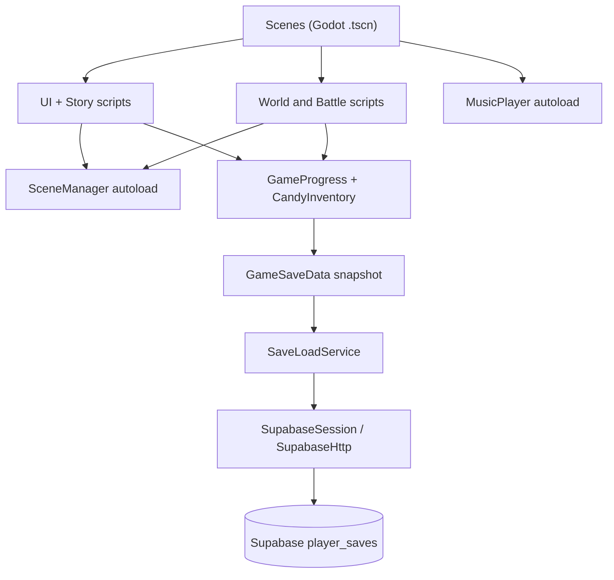

# Architecture and code relationships

## Main execution graph

## Ownership boundaries

| Area | Source of truth | Consumers | Notes |
| --- | --- | --- | --- |
| Cleared story levels | `GameProgress` | World building gates, battle win, journal, collections | Only expected *victory* advances progress. |
| Party, candy, friendship, pickups | `CandyInventory` | Battle, Party overlay, candy pickups, bonding moment | Stable index order defined in `YokaiRoster`; `Changed` invalidates unsaved state. |
| Profile and overworld location | `PlayerData` | Character creation, world spawn, cloud session | Gender chooses existing male/female player scene. |
| One save snapshot | `GameSaveData` | `SaveLoadService`, `World` | JSON version 4; older versions default missing fields. |
| Cloud persistence | `SaveLoadService` | Save panels, Continue, autosave | Uses `SupabaseSession` and `SupabaseHttp` with existing backend policies. |
| Global scene fade | `SceneManager` | Main menu, dialogue, world, battle, ending | Persistent autoload manages fades and pause/settings overlays. |
| Music and volume | `MusicPlayer` | Scene changes, opening promise | Dedicated opening score plus world/battle music; settings retained locally. |
| Encounter sprite/skills | `YokaiRoster` | `BattleScene`, `PartyInventory`, bond/title cards | Do **not** reorder arrays without migrating old saves. |

## Important behavior

1. **Player account** is created through CharacterCreation and the configured Supabase player endpoint; Continue selects an existing account and reads cloud slots.
2. **Start** flows into OpeningCutscene, then World. The story of Whisper and the exorcist family provides the reason to save Wawa.
3. **World** spawns the selected player scene under `MapBackground`, applies existing building collision/damage decorations, and creates the HUD and autosave trigger.
4. **Building entry** scripts call `GameProgress.EnterBuilding` with their stage and dialogue scene. Stage mismatch returns a friendly journal notice.
5. **Dialogue** confirms once then fades to a battle. `BattleScene` selects stage by the current scene filename, loads roster sprites and skill references, and drives HP/friendship effects.
6. **Win** calls `CompleteLevel`; BattleResultUI confirms the result. Stage 2 onward shows a one-time companion bond. Stage 7 can continue to Ending. **Run** and **loss** return to World with no progress change.
7. **Autosave** serializes GameSaveData via SaveLoadService; old scene strings are still accepted by PrepareLoad.

## Scene and UI specifics

- In-world UI (journal/party) are runtime CanvasLayer controls: their distinct dark teal, brass, parchment and moss theme comes from `YokaiTheme`.
- `BossTitleCard` is injected for stage 7 (Orcanos) only. The battle continues after its cinematic overlay fades or the player skips it.
- `YokaiBondCutscene` does not create a second Yokai or progress trigger. It only celebrates a first-time unlock already recorded by GameProgress; feeding uses the existing single-source CandyInventory.
- The new soundtrack is generated reproducibly by `tools/generate_opening_score.py` as an original OGG. It lives at `Music/WhisperPromise.ogg` and is used on new-game opening scenes.
- Main scene is explicitly `res://Scenes/Menus/main_menu.tscn`; autoload paths are specified directly so stale UID caches cannot point at the old root filenames.

## Stability precautions

- `.cs.uid` files moved alongside scripts, and the missing collision-generator sidecar is restored with its original scene-referenced UID.
- `tools/verify_project_paths.py` scans all static `res://` links and script UID references.
- Prior cloud saves keep working because the loader recognizes both old and new world scene strings.
- Existing collision geometry and building layouts are preserved; organization changes do not reauthor the Wawa map.
- New C# functionality requires a Godot **.NET** editor build to compile and test; the non-.NET Godot command-line executable cannot validate C# loading.
