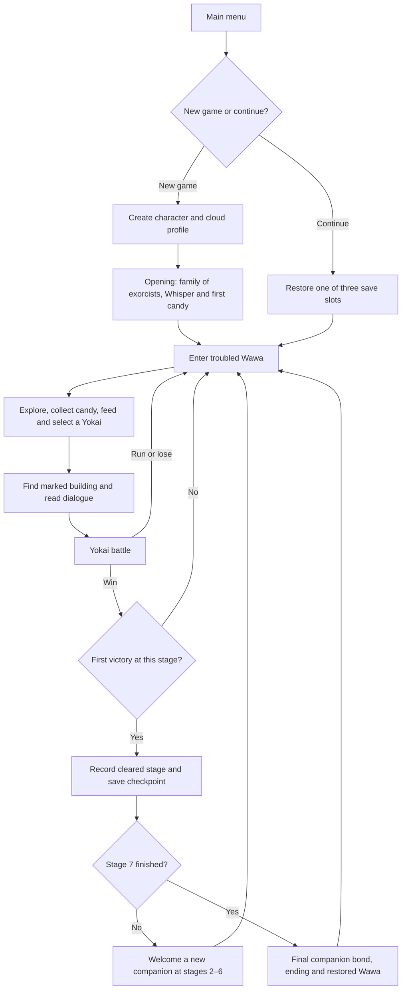
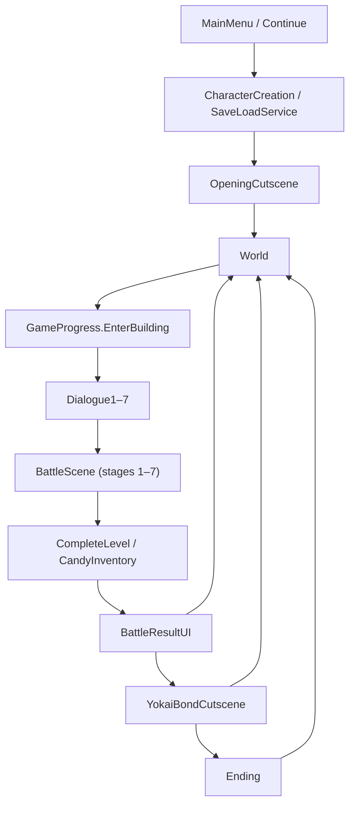

# Yokai Wave — Gameplay Flow

The story is linear across seven district battles. Players can explore, collect candy, change active Yokai, and strengthen friendships between victories.

## Story districts

| Stage | Location | Yokai / story role | Progress condition |
| ---: | --- | --- | --- |
| 0 | Family home / Wawa | Meet Whisper; first candy and family's promise | Complete opening |
| 1 | House 2 | First disturbance, first battle tutorial | Defeat opponent |
| 2 | Sari-Sari Store | Tattletell joins after victory | Defeat opponent |
| 3 | Gas Station | Cheeksqueek joins after victory | Defeat opponent |
| 4 | Puregold | Draggie joins after victory | Defeat opponent |
| 5 | McDonald's | Enma joins after victory | Defeat opponent |
| 6 | School | Wobblewok joins after victory | Defeat opponent |
| 7 | Haunted House | Orcanos; final boss title reveal | Defeat opponent and view epilogue |

## Systems and conditions

- **Entry gating:** `GameProgress.EnterBuilding` only opens the encounter when its stage equals `CompletedLevels + 1`; otherwise a styled progress message explains the lock.
- **Victory gating:** `GameProgress.CompleteLevel` advances on a win at the expected stage only. Entering, fleeing, or losing a battle cannot advance progress.
- **Companions:** `CandyInventory.AvailablePartners` derives from cleared stages; Whisper is always the starter. `YokaiRoster` ties stable indices to names, portraits, skills, and battle sprites.
- **Bonding:** the post-victory interaction at stages 2–7 offers a candy gift (one candy is actually deducted and friendship advances) or a free welcoming hug. The cutscene appears only when the stage clears for the first time.
- **Saving:** entering the town with pending progress triggers an autosave; cloud slots store level, location, candy, friendship, chosen Yokai, and collected pickup IDs.
- **Scene changes:** `SceneManager.TransitionTo` masks changes with a short fade. The opening uses its own in-scene cinematic transitions.

## Scene flow by code

